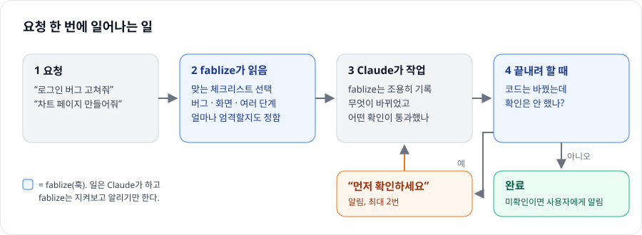

[English](README.md) | 한국어

# fablize — Opus를 Fable처럼

[](https://github.com/cakel/fablize/stargazers)
[](https://opensource.org/licenses/MIT)

Claude에게 좋은 일 습관을 붙여 주는 Claude Code 플러그인입니다. 만든 건 직접 돌려 보고, "다 했다"고 하기 전에 확인하고, 버그는 짐작하지 말고 차근차근 원인을 찾게 합니다.

## 어떤 생각에서 나왔나

AI 코딩 모델은 똑똑하지만, 확인도 안 하고 "끝났다"고 하거나 중간에 멈출 때가 있습니다. 가장 강한 모델은 그런 일이 드뭅니다. 그 차이의 일부는 타고난 능력이라 어떤 플러그인으로도 채울 수 없습니다. 나머지는 **습관**이고, 습관은 옮겨 줄 수 있습니다.

fablize는 세 가지로 습관을 옮겨 줍니다.

- **지금 하는 일에 맞는 체크리스트.** 버그를 고친다면 먼저 재현하고, 가능한 원인 여러 개를 비교하고, 고쳤다는 걸 증명합니다. 화면이나 차트를 만든다면 직접 열어서 봅니다. 단계가 많다면 나눠서 하나씩 끝냅니다.
- **끝내기 전 "확인했어?"** 철저한 작업에서 코드를 바꾸고 확인을 한 번도 안 했다면 최대 두 번까지 알려 줍니다. 그래도 안 하면 사용자에게 "확인 안 된 변경"이라고 알립니다.
- **단계 관리 도구.** 여러 단계 작업에서, 실제 테스트 명령이 통과하기 전에는 마지막 단계를 완료로 치지 않습니다.

<p align="center">
  
</p>

못 하는 것도 있습니다. 모델을 더 똑똑하게 만들지는 못합니다. 능력이 더 필요한 문제라면 흉내 내지 않고 그렇다고 말합니다.

## 설치

Claude Code에서:

```
/plugin marketplace add cakel/fablize
/plugin install fablize@cakel
```

이걸로 끝입니다. 체크리스트와 "확인했어?" 알림이 바로 동작합니다.

- **Windows:** 훅이 Git Bash에서 돌기 때문에 [Git for Windows](https://git-scm.com/download/win)와 Python 3.8 이상이 필요합니다.
- **선택, 항상 켜기:** 모든 세션에서 작업 규칙을 Claude 컨텍스트에 두려면 한 번 실행합니다.
  ```
  bash "${CLAUDE_PLUGIN_ROOT}/setup/setup.sh" local    # 이 프로젝트만 — 또는 global
  ```
  셋업이 저장소에 ⭐를 눌러 줄지 한 번 물어볼 수 있습니다. "예"라고 하지 않으면 아무것도 누르지 않습니다.
- **제거:** `bash "${CLAUDE_PLUGIN_ROOT}/setup/uninstall.sh" local`(또는 `global`) 후 `/plugin uninstall fablize@cakel`.

## 쓰는 법

평소처럼 일하면 됩니다. fablize는 요청 내용에 맞춰 반응합니다.

| 이렇게 말하면 | fablize가 더하는 것 |
|---|---|
| "로그인 테스트가 왜 실패하는지 찾아줘" | 버그 체크리스트: 재현, 원인 후보 여러 개, 고쳤다는 증명 |
| "대시보드 페이지 만들어줘" | 화면 체크리스트: 다 됐다고 하기 전에 열어서 보기 |
| "인증 모듈 철저히 리팩터해줘" | 끝내기 전에 확인을 돌리라는 알림 |
| "리팩터해줘, 테스트는 돌리지 마" | 알림 없음. Claude는 아무것도 실행하지 않고, 확인 안 된 변경이라고 말해 줌 |

`/fablize`나 "끝까지 해줘" 같은 말로 일부러 켤 수도 있습니다.

## 더 알아보기

- [동작 방식](docs/GUIDE.ko.md): 구성요소, 작업 모드, 끝내기 전 확인, 디스크에 남기는 것, 한계
- [미결 결정](docs/DECISIONS.md): 아직 고민 중인 설계와 판단에 쓰는 로그
- [측정 프로토콜](docs/MEASUREMENT_PROTOCOL.md): 효과를 어떻게 재는지
- [변경 기록](CHANGELOG.md)

> [`fivetaku/fablize`](https://github.com/fivetaku/fablize)(upstream 2.1.1)의 fork이며 자체 수정을 포함합니다. 버전은 `2.1.1+cakel.<n>` 형식입니다.
>
> cakel.7–8 작업(리뷰, 수정, 테스트, 문서)은 Claude Code에서 **Sonnet 5.5**와 **Opus 5.5**로 진행했습니다 — [사용한 모델](docs/GUIDE.ko.md#이-fork-작업에-쓴-모델) 참고.

## 라이선스

MIT — [LICENSE](LICENSE) 참고.
