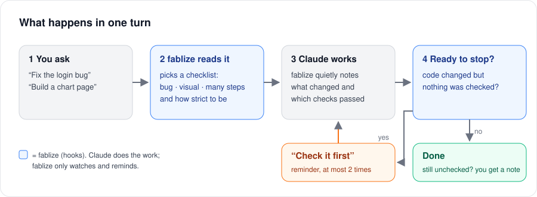

English | [한국어](README.ko.md)

# fablize — run Opus like Fable

[](https://github.com/cakel/fablize/stargazers)
[](https://github.com/cakel/fablize/actions/workflows/tests.yml)
[](https://opensource.org/licenses/MIT)

A Claude Code plugin that gives Claude good work habits: run what you build, check before you say "done", and track down a bug step by step instead of guessing.

## The idea

AI coding models are smart, but they sometimes say "done" without checking, or stop halfway. The strongest model mostly doesn't. Part of that gap is raw ability, which no plugin can add. The other part is **habits**, and habits can be handed over.

fablize hands them over in three ways:

- **A checklist for the job in front of it.** Fixing a bug? Reproduce it first, compare several possible causes, and prove the fix. Building a page or a chart? Open it and look at it. Many steps? Split them up and finish each one.
- **A "did you check it?" before it stops.** If Claude changed code on a thorough task and never ran a check, fablize reminds it, at most twice, and then tells you the change is unverified.
- **A step tracker** for multi-step work, which won't mark the last step done until a real test command passes.

<p align="center">
  
</p>

What it can't do: make the model smarter. If a problem needs more raw ability, fablize says so instead of pretending.

## Install

In Claude Code:

```
/plugin marketplace add cakel/fablize
/plugin install fablize@cakel
```

That's it. The checklists and the "did you check it?" reminder start working right away.

- **Windows:** install [Git for Windows](https://git-scm.com/download/win) (the hooks run in Git Bash) and Python 3.8 or newer.
- **Optional, always on:** to keep the work rules in Claude's context in every session, run once:
  ```
  bash "${CLAUDE_PLUGIN_ROOT}/setup/setup.sh" local    # this project only — or: global
  ```
  Setup may ask once whether you'd like to star the repo. It never stars anything unless you say yes.
- **Uninstall:** `bash "${CLAUDE_PLUGIN_ROOT}/setup/uninstall.sh" local` (or `global`), then `/plugin uninstall fablize@cakel`.

## Using it

Just work as usual. fablize reacts to what you ask:

| You say | fablize adds |
|---|---|
| "Find out why the login test fails" | the bug checklist: reproduce, several causes, prove the fix |
| "Build a dashboard page" | the visual checklist: open it and look before calling it done |
| "Refactor the auth module thoroughly" | the reminder to run a check before finishing |
| "Refactor it, but don't run the tests" | no reminder. Claude doesn't run anything and tells you the change is unchecked |

You can also start it on purpose with `/fablize` or phrases like "see it through".

## Learn more

- [How it works](docs/GUIDE.md): each part, task modes, the stop check, what it writes to disk, and its limits
- [Open decisions](docs/DECISIONS.md): design choices still being weighed, and the logs used to decide them
- [Measurement protocol](docs/MEASUREMENT_PROTOCOL.md): how the effect is being measured
- [Changelog](CHANGELOG.md)

> This is a fork of [`fivetaku/fablize`](https://github.com/fivetaku/fablize) (upstream 2.1.1) with its own fixes; versions read `2.1.1+cakel.<n>`.
>
> The cakel.7–8 work (reviews, fixes, tests, docs) was done in Claude Code with **Sonnet 5.5** and **Opus 5.5**, with a final code review by **Fable 5.1** — see [Models used](docs/GUIDE.md#models-used-for-this-fork).

## License

MIT — see [LICENSE](LICENSE).
