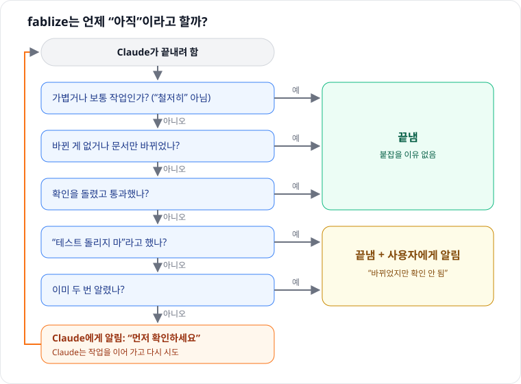

[English](GUIDE.md) | 한국어 · [← README](../README.ko.md)

# fablize 동작 방식

## 왜 만들었나

Fable 5가 나온 뒤 upstream 작성자가 Fable 5와 Opus 4.8을 같은 작업으로 비교했습니다(A/B 19런과 실작업 26세션, 도구 호출 약 1,500회).

- 정답이 있는 닫힌 작업(코드, 로직, 빌드)에서는 둘이 거의 같았습니다.
- 차이는 열린 작업에서 났습니다. Fable은 함의를 한 걸음 더 따라갔습니다.
- 그 깊이는 **능력**입니다. Opus에게 그렇게 하라고 시켜도 안 됐습니다. Fable이 혼자 찾은 결함을 Opus는 찾지 못했습니다.
- 반면 **일하는 방식**은 옮겨졌습니다. 만든 걸 실제로 돌려 보기, 끝까지 가기, 차근차근 조사하기입니다.

그래서 fablize는 일하는 방식을 묶어 둡니다. 모델의 천장을 올리지는 않고, 모델이 자기 천장까지 가도록 돕습니다.

| 특성 | 옮겨지나 | 이유 |
|---|:--:|---|
| 돌려 보고 결과를 보기 | ✅ 탑재 | Opus가 "못 해서가 아니라 안 해서" 빠뜨린 습관. 넣어 주자 렌더 확인이 측정 가능하게 늘었음 |
| 모든 단계를 증거와 함께 끝내기 | ✅ 탑재 | 절차: 나누기, 체크포인트, 증거 없는 "완료" 거부 |
| 차근차근 조사 (재현 → 원인 → 인과 사슬) | ✅ 탑재 | 절차. 강한 모델은 이미 하는 것 |
| "하겠다"만 하고 안 하는 것 잡기 | ⚙️ 선택 | 작은 훅. 함께 배포되지만 직접 켜야 함 |
| 아무도 명시하지 않은 결함 찾기 | ❌ | 능력. 시켜 봤지만 실패 |
| 정답 없는 창작 디테일 | ❌ | 능력 |
| 시키지 않아도 더 깊이 파기 | ❌ | 능력. 시킨 깊이는 옮겨지지만 스스로 시작하는 깊이는 안 됨 |

## 이 fork 작업에 쓴 모델

cakel.7–8 릴리스는 Claude Code에서 아래 모델로 만들었습니다.

| 모델 | 쓴 곳 |
|---|---|
| **Sonnet 5.5, Opus 5.5** | 코드 리뷰 라운드와 수정 |
| **Fable 5.1** | 마지막 단계 코드 리뷰 (2026-10-23) |
| **Opus 5.5** | 스킬 감사, 결정 로그, 문서 |
| **Sonnet 5.5, Opus 5.5** | 2026-10-24 스킬 유무 비교 (6회, 숨은 테스트) |
| **Opus 5.5** | 깨끗한 Windows PC에서 실세션 스모크 테스트 (Claude Code 2.1.310, 0~9번 통과) |

fablize의 목적은 Opus나 Sonnet 같은 모델이 Fable처럼 일하게 하는 것이라, fork는 이 모델들로 확인했습니다.

## 구성요소

| 구성요소 | 하는 일 | 실행 방식 | 효과 |
|---|---|---|---|
| **화면 확인** | HTML·SVG·게임·차트는 열어 보고, 본 것을 고침 | 체크리스트, 프롬프트에 해당 신호가 있으면 추가 | 측정됨 (upstream A/B) |
| **버그 체크리스트** | 먼저 재현, 원인 후보 3개 이상, 후보마다 증거, 바꾼 코드의 다른 호출부 전부 확인, 고치기 전에 실패하는 회귀 테스트 | 체크리스트, 버그 신호가 있으면 추가 | 미측정 |
| **라우터** | 프롬프트에서 버그·화면 신호를 찾아 맞는 체크리스트를 더함 | `UserPromptSubmit` 훅, 자동 | 미측정 (HOLD) |
| **끝내기 전 확인** | 요청을 quick / normal / deep으로 나누고, deep 작업에서 코드를 바꿨는데 통과한 확인이 없으면 먼저 확인하라고 함 | `UserPromptSubmit`·`PostToolUse`·`Stop` 훅, 자동 | 미측정 (HOLD) |
| **실패 안내** | 확인이 실패하면 "완료"라고 보고하지 말라고 하고, 같은 실패가 두 번 나면 조용히 재시도하지 말고 알리라고 함 | `PostToolUse` / `PostToolUseFailure` 훅, 자동 | 미측정 (HOLD) |
| **단계 관리** (`goals.py`) | 작업을 단계로 나누고 진행을 `./.fablize/`에 저장, 마지막 단계는 테스트 명령을 직접 실행해 통과해야 완료 | 스킬 또는 항상 켜기 규칙 | 미측정 |
| **조기 종료 훅** (`finish-the-work.sh`) | 약속만 하고 끝나는 마지막 메시지를 막음 | `Stop` 훅, **선택** | 미측정 |

"미측정"은 켜져 있다는 뜻이지, 효과가 입증됐다는 뜻이 아닙니다. 2026-10-24 점검(원인을 심어 둔 버그 저장소 2개, Sonnet·Opus, 스킬 유무, 숨은 테스트)에서는 양쪽 모두 6/6 통과해 차이를 가르지 못했습니다. 과제가 너무 쉬웠습니다. 탑재하지 않은 것: 말투 모방, 넓은 추론 주입, 리뷰 리콜 스캔.

## 작업 모드

요청마다 모드가 정해집니다. 끝에 Claude를 붙잡을 수 있는 건 **deep**뿐입니다.

| 모드 | 이런 요청일 때 | Claude가 받는 안내 |
|---|---|---|
| quick | 설명·확인만 원하거나, 짧고 작업 단어가 없음 | 짧게. 확인은 필요 없음 |
| normal | 작업을 시킴(고쳐, 만들어, 테스트), 또는 버그를 말함("빌드가 깨졌어") | 파일이 바뀌면 관련 확인 하나 실행 |
| deep | 철저히·리팩터·배포·인증·마이그레이션 등, 또는 운영 환경·DB를 건드림 | 증명 방법을 먼저 정하고, 끝내기 전에 변경을 검증 |

"응 진행해" 같은 짧은 후속 말은 이전 모드를 이어 갑니다. "설명만"은 언제나 quick입니다.

## 끝내기 전 확인

<p align="center">
  
</p>

- **요청당 알림은 최대 두 번.** 그 뒤에는 Claude가 끝내고, 사용자에게 "files changed this turn but no successful verification was observed"가 보입니다.
- **사용자 말이 우선.** "테스트 돌리지 마", "어떤 명령도 돌리지 마"라고 하면 알림이 없습니다. Claude는 아무것도 실행하지 말고 확인 안 된 변경이라고 말하라는 안내를 받습니다.
- **백그라운드 작업 중에는 멈춤.** 테스트 실행이나 서브에이전트가 아직 돌고 있으면 세션이 끝난 게 아니므로 붙잡지 않습니다.
- **오류가 나면 통과.** 내부 오류가 나면 Claude가 그냥 끝낼 수 있게 합니다.
- **확인을 읽는 방법.** 셸 명령(pytest, npm test, cargo test, go test, make check, `python test_x.py` 등)과 그 출력을 해석합니다. `; echo "exit=$?"`로 끝나는 경우도 포함합니다. 휴리스틱이라 가끔 잘못 알리거나 놓칠 수 있습니다.

## 여러 단계 작업

Claude가 대신 실행합니다. 무슨 일이 일어나는지 알 수 있게 보여 드립니다.

```bash
goals() { bash "${CLAUDE_PLUGIN_ROOT}/hooks/py.sh" "${CLAUDE_PLUGIN_ROOT}/scripts/goals.py" "$@"; }
goals create --brief "내보내기 추가" --goal "parser::행 파싱" --goal "verify::테스트 통과"
goals next                                       # 다음 단계 시작
goals checkpoint --id G001 --status complete --evidence "형식 3가지 처리"
goals next
goals checkpoint --id G002 --status complete --evidence "완료" --verify-cmd "pytest -q"
goals status                                     # 지금 어디까지? (재시작 후에도)
```

마지막 단계는 `--verify-cmd`를 직접 실행하고 exit 0일 때만 완료됩니다. `true`, `echo`처럼 아무것도 증명하지 않는 명령은 거부합니다. 막힌 단계는 `next --reopen G001`로 다시 시도합니다.

## 남기는 데이터

모두 내 컴퓨터에만 남습니다.

- `~/.fablize/ledgers/<session>.json`: 세션별 끝내기 전 확인 기록(모드, 바뀐 파일 종류, 본 확인 명령)
- `~/.fablize/history/events.jsonl`: 결정마다 한 줄(라우터 신호, 알림, 경고, 조기 종료 차단). 라벨과 짧은 매칭 단어만 남고 프롬프트는 남지 않음. `FABLIZE_EVENTS=0`으로 끔
- 저장소의 `./.fablize/`: 단계 관리 계획과 로그(테스트 명령 출력 끝부분 포함). 원하면 `.gitignore`에 추가
- `FABLIZE_DATA=<폴더>`로 앞의 두 개 위치를 바꿀 수 있음

## 설치 세부

- **항상 켜기 규칙:** `setup/setup.sh local|global`이 `CLAUDE.md`에 짧은 규칙 블록을 넣고(백업 생성) 참조 파일을 `~/.fablize/lib`에 복사합니다. 플러그인을 업데이트하면 다시 실행하세요. 오래된 상태면 fablize가 세션당 한 번 알려 줍니다.
- **조기 종료 훅:** 셋업이 `~/.fablize/lib/hooks/finish-the-work.sh`를 설정의 `Stop` 훅으로 등록하는 방법을 출력합니다. 기본은 꺼져 있습니다([D4](DECISIONS.md) 참고).
- **Windows:** 훅은 Git Bash로 돌고, `hooks/py.sh`가 `python3`, `python`, `py`를 찾습니다. Python이 없으면 훅은 아무것도 하지 않습니다.
- **제거:** `setup/uninstall.sh local|global`이 블록을 지웁니다. 훅은 `/plugin uninstall fablize@cakel` 전까지 남습니다.

## 한계

- 능력은 못 올립니다. 정답 없는 창작의 완성도와 스스로 시작하는 발견은 플러그인 설정이 아니라 모델 선택의 영역입니다.
- 측정 수치는 작은 Claude 단일 가족 자기 측정(19런)에서 나왔고, 화면 확인만 다룹니다.
- 끝내기 전 확인이 셸 명령을 읽는 방식은 휴리스틱입니다(위 참고).
- 조기 종료 훅을 켜면 "원하시면 보고서를 작성하겠습니다"를 약속으로 오인할 수 있습니다. 제안은 물음표로 끝내세요.

## 더 보기

- [미결 결정](DECISIONS.md): 아직 정하지 않은 것, 지금까지의 근거, `events.jsonl` 조회 방법
- [측정 프로토콜](MEASUREMENT_PROTOCOL.md)
- [변경 기록](../CHANGELOG.md)
