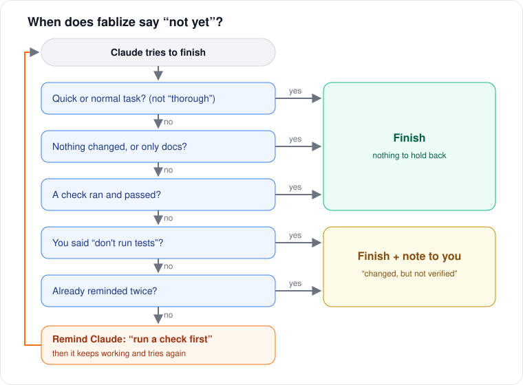

English | [한국어](GUIDE.ko.md) · [← README](../README.md)

# How fablize works

## Why it exists

When Fable 5 shipped, the upstream author compared Fable 5 and Opus 4.8 on the same work (an A/B set of 19 runs plus 26 real working sessions, about 1,500 tool calls):

- On closed work with a right answer (code, logic, builds), the two were about even.
- The gap showed up on open-ended work: Fable followed an implication one step further.
- That extra depth is **ability**. Telling Opus to do it didn't work: Opus could not find the defects Fable found on its own.
- But the **way of working** did transfer: actually running what you build, seeing a task through, investigating step by step.

So fablize packages the way of working. It doesn't raise the model's ceiling; it helps the model reach its own.

| Trait | Transfers? | Why |
|---|:--:|---|
| Run it and look at the result | ✅ shipped | Opus skipped it "not because it couldn't, but because it didn't". Adding the habit measurably raised render checking. |
| Finish every step, with proof | ✅ shipped | A procedure: split, checkpoint, refuse "done" without proof. |
| Investigate step by step (reproduce → causes → full chain) | ✅ shipped | A procedure. Strong models already do it. |
| Catch "I'll do X" with no X | ⚙️ opt-in | A small hook. Shipped, but you turn it on yourself. |
| Find defects nobody specified | ❌ | Ability. Telling the model to do it was tried and failed. |
| Fine creative detail with no right answer | ❌ | Ability. |
| Going deeper without being asked | ❌ | Ability. Asked-for depth transfers; self-started depth doesn't. |

## Models used for this fork

The cakel.7–8 releases were built in Claude Code with these models:

| Model | Used for |
|---|---|
| **Sonnet 5.5, Opus 5.5** | code review rounds and fixes |
| **Opus 5.5** | the skill audit, the decision log, the docs |
| **Sonnet 5.5, Opus 5.5** | the 2026-10-24 with/without-skill check (6 runs, hidden tests) |
| **Opus 5.5** | the real-session smoke test on a clean Windows PC (Claude Code 2.1.310, steps 0–9 pass) |

The point of fablize is to make models like Opus and Sonnet work the way Fable does, so the fork was checked against them.

## The parts

| Part | What it does | How it runs | Effect |
|---|---|---|---|
| **Visual check** | HTML, SVG, games, charts: open it, look at it, fix what you see | checklist, added when your prompt mentions one | measured (upstream A/B) |
| **Bug checklist** | reproduce first, 3+ possible causes, evidence for each, check every other caller of the code you change, a regression test that fails before the fix | checklist, added on a bug signal | not measured |
| **Router** | spots the bug / visual signal in your prompt and adds the matching checklist | `UserPromptSubmit` hook, automatic | not measured (HOLD) |
| **Stop check** | sorts each request as quick / normal / deep; on deep work that changed code with no passing check, asks Claude to check first | `UserPromptSubmit`, `PostToolUse`, `Stop` hooks, automatic | not measured (HOLD) |
| **Failure note** | after a failed check, tells Claude not to report "done"; after the same failure twice, tells it to say so instead of retrying quietly | `PostToolUse` / `PostToolUseFailure` hooks, automatic | not measured (HOLD) |
| **Step tracker** (`goals.py`) | splits work into steps, saves progress in `./.fablize/`, runs your test command itself before the last step can finish | skill or always-on rules | not measured |
| **Early-stop hook** (`finish-the-work.sh`) | blocks a last message that only promises work | `Stop` hook, **opt-in** | not measured |

"Not measured" means the part is on, not that it's proven to help. A 2026-10-24 check (two bug repos with a planted root cause, Sonnet and Opus, with and without the skill, hidden tests) passed 6/6 either way. The tasks were too easy to tell the two apart. Not shipped: style mimicry, broad reasoning injection, a review-recall scan.

## Task modes

Every request gets a mode. Only **deep** can hold Claude back at the end.

| Mode | Picked when the request… | What Claude is told |
|---|---|---|
| quick | asks to explain or check, or is short with no work words | keep it short; no check needed |
| normal | asks for work: fix, build, test, or describes a bug ("the build is broken") | if files change, run one relevant check |
| deep | says thorough / refactor / deploy / auth / migration…, or touches production or a database | decide the proof first; verify the change before finishing |

A short follow-up like "yes, go ahead" keeps the previous mode. "Just explain" always means quick.

## The stop check

<p align="center">
  
</p>

- **At most two reminders per request.** After that Claude finishes, and you see "files changed this turn but no successful verification was observed".
- **Your word wins.** Say "don't run the tests" or "어떤 명령도 돌리지 마" and there is no reminder: Claude is told not to run anything and to say the change is unchecked.
- **Background work pauses it.** While a test run or subagent is still going, the session isn't done, so nothing is held back.
- **It fails open.** Any internal error lets Claude finish.
- **How it reads a check.** It parses the shell command (pytest, npm test, cargo test, go test, make check, `python test_x.py`, …) and its output, including `; echo "exit=$?"` endings. That parsing is a heuristic: expect an occasional wrong reminder, or a missed one.

## Multi-step work

Claude runs these for you; they're shown so you know what happens.

```bash
goals() { bash "${CLAUDE_PLUGIN_ROOT}/hooks/py.sh" "${CLAUDE_PLUGIN_ROOT}/scripts/goals.py" "$@"; }
goals create --brief "add export" --goal "parser::parse rows" --goal "verify::tests pass"
goals next                                       # start the next step
goals checkpoint --id G001 --status complete --evidence "parser handles 3 formats"
goals next
goals checkpoint --id G002 --status complete --evidence "done" --verify-cmd "pytest -q"
goals status                                     # where am I? (after a restart too)
```

The last step runs `--verify-cmd` itself and only completes on exit 0. A command that proves nothing, like `true` or `echo`, is refused. A blocked step can be retried with `next --reopen G001`.

## What it writes

Everything stays on your machine.

- `~/.fablize/ledgers/<session>.json`: the stop check's notes for the session (mode, kinds of files changed, check commands it saw).
- `~/.fablize/history/events.jsonl`: one line per decision (router signal, reminder, warning, early-stop block). Labels and short matched words only, never your prompt. Turn it off with `FABLIZE_EVENTS=0`.
- `./.fablize/` in your repo: step-tracker plans and their log (including the test command's last output lines). Add it to `.gitignore` if you like.
- `FABLIZE_DATA=<dir>` moves the first two.

## Setup details

- **Always-on rules:** `setup/setup.sh local|global` writes a short rules block into `CLAUDE.md` (with a backup) and copies the files it points at to `~/.fablize/lib`. Re-run it after a plugin update; fablize tells you once per session when it's out of date.
- **Early-stop hook:** setup prints how to register `~/.fablize/lib/hooks/finish-the-work.sh` as a `Stop` hook in your settings. It's off by default (see [D4](DECISIONS.md)).
- **Windows:** hooks run through Git Bash; `hooks/py.sh` finds `python3`, `python` or `py`. If no Python is found, the hooks do nothing.
- **Uninstall:** `setup/uninstall.sh local|global` removes the block. The hooks stay until `/plugin uninstall fablize@cakel`.

## Limits

- It can't raise ability. Open-ended creative quality and self-started discovery are a model choice, not a plugin setting.
- The measured numbers come from a small Claude-only self-measurement (19 runs), and they cover only the visual check.
- The stop check's reading of shell commands is a heuristic (see above).
- The early-stop hook, if you turn it on, can mistake "I'll write the report if you want" for a promise. End offers with a question mark.

## More

- [Open decisions](DECISIONS.md): what is still undecided, the evidence so far, and the queries to run on `events.jsonl`
- [Measurement protocol](MEASUREMENT_PROTOCOL.md)
- [Changelog](../CHANGELOG.md)
